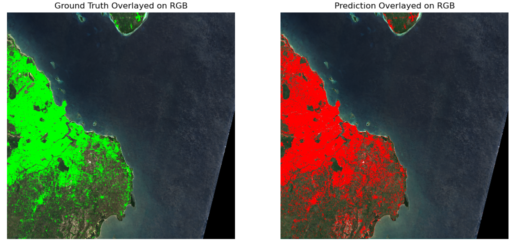
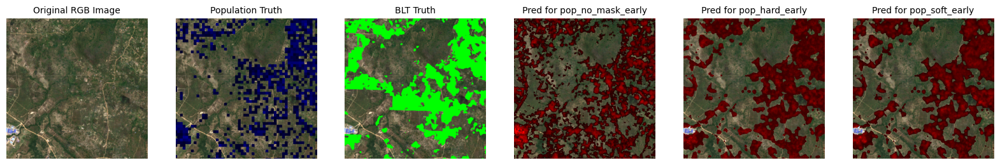
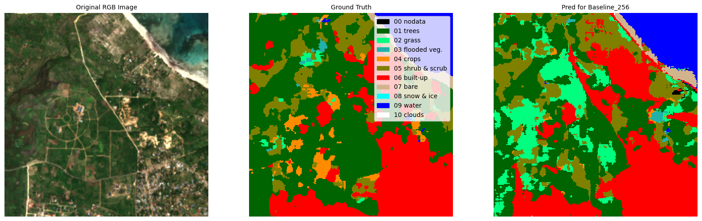

# Image Based Mapping: deep learning on satellite imagery

Solutions to the three coding assignments of the Image Based Mapping course at ETH Zürich (autumn 2023), graded 19/20, 19/20 and 21/20. Group work with Sophia Demmel and Marguerite Larriere.

Each assignment maps a different quantity from the same Sentinel-2 imagery (RGB and near-infrared, 10 m resolution, 16 to 36 acquisitions per tile from 2020): built-up area, population density and land cover. The models are trained on four tiles and tested on a fifth, the Dar es Salaam region in Tanzania (`DAR`), that is never used in training.

| Assignment | Task | Main result |
|---|---|---|
| [2](assignment2/main.ipynb) | Built-up area segmentation | F1 0.79 on the held-out tile |
| [3](assignment3/main.ipynb) | Population density regression | A predicted built-up mask lowers the held-out MAE by about 20% |
| [4](assignment4/validation_testing.ipynb) | Land-cover classification from image time series | Macro F1 0.58 on the held-out tile; temporal fusion did not beat the single-date model |

The notebooks are 9 to 27 MB because of their embedded plots, so GitHub may not render them. The main numbers and one figure per task are below.

## Assignment 2: built-up area

Binary segmentation of built-up pixels from a cloud-free median composite. About 7% of the validation pixels are built-up, so accuracy says little and the scores below are for the built-up class.

- A per-pixel linear classifier predicts "not built-up" everywhere (F1 0).
- A small U-Net-like CNN reaches a validation F1 of 0.61. Weighting the built-up class by 1.5 in the loss raises it to 0.64.
- Higher class weights, a larger network with batch normalisation and dropout, and augmentation all stay between 0.63 and 0.65 on validation.
- On the held-out tile, the augmented CNN with class weight 1.5 scores **F1 0.79** (precision 0.78, recall 0.80). The test tile is mostly ocean and dense city, while the training tiles contain small, scattered settlements, which is the likely reason the test score is above the validation score.

  
   
  Held-out Dar es Salaam tile: built-up labels (green) and predictions (red).

## Assignment 3: population density

Per-pixel regression of population density (labels at 100 m, resampled to 10 m). The question was whether knowing where buildings are helps: a built-up U-Net with the architecture from assignment 2 is pretrained and frozen, and its output multiplies the population prediction, either as a binary mask (hard) or as a probability (soft).

Two training inputs are compared: the cloud-free median composite of each tile ("early fusion" in the notebook) and all single acquisitions ("late fusion"). Errors are on the normalised log-transformed target; the test columns are for the cloud-free composite of the held-out tile.

| Training input | Mask | Validation MAE | Validation RMSE | Test MAE | Test RMSE |
|---|---|---|---|---|---|
| Composite | none | 0.102 | 0.144 | 0.046 | 0.110 |
| Composite | hard | 0.077 | 0.146 | **0.036** | 0.096 |
| Composite | soft | 0.082 | 0.136 | 0.037 | **0.095** |
| Single acquisitions | none | 0.103 | 0.132 | 0.045 | 0.112 |
| Single acquisitions | hard | **0.074** | 0.139 | 0.051 | 0.141 |
| Single acquisitions | soft | 0.075 | **0.130** | 0.043 | 0.115 |

- **The mask helps the composite model.** On the held-out tile both masks lower its MAE by about 20% and its RMSE by about 13%. Without a mask the model also predicts population between settlements (figure below).
- **It does not transfer for the single-acquisition models.** Their masked variants are better on validation, but on the held-out tile the hard mask is worse than no mask and the soft mask is about equal.
- **The input has to match the use.** On the 16 single, partly cloudy acquisitions of the held-out tile, the model trained on single acquisitions is better on every date (RMSE 0.12 to 0.17, against 0.13 to 0.28 for the composite model, both with the soft mask).
- The two inputs use networks of different depth and were tuned separately, so differences between them are not due to the input alone.

The test numbers are from our report; the test cell of the notebook has no stored output.

  
   
  Held-out tile: image, population label (blue), built-up label (green) and predictions of the composite model without mask, with the hard mask and with the soft mask (red).

## Assignment 4: land cover from time series

Segmentation into eight land-cover classes (Dynamic World labels: trees, grass, flooded vegetation, crops, shrub and scrub, built-up, bare, water) from single acquisitions, clouds included. The question was whether using several dates of the same place helps.

- **No fusion:** a four-level U-Net on one date.
- **Early fusion:** the current and the two or four previous dates stacked as input channels, optionally with attention gates.
- **Score fusion:** the frozen single-date U-Net applied to each date, with a separate network of pooling and fully connected layers that merges its per-date features.

Macro F1 over the eight classes on 256 × 256 patches:

| Model | Dates | Validation | Held-out tile |
|---|---|---|---|
| Three-level baseline | 1 | 0.31 | 0.27 |
| U-Net | 1 | 0.58 | 0.58 |
| U-Net, class-weighted loss | 1 | 0.58 | 0.58 |
| Early fusion | 3 | 0.58 | |
| Early fusion with attention | 3 | 0.50 | |
| Early fusion | 5 | 0.53 | |
| Score fusion | 3 | 0.30 | |
| Score fusion | 5 | 0.26 | |

- **Temporal fusion did not help.** Early fusion with three dates matches the single-date U-Net on validation; five dates and attention are worse. Each model was trained once, for 30 to 50 epochs, and the early-fusion losses were still falling, so longer training might change the order.
- **Score fusion did not train.** Its loss stopped falling after three to four epochs, probably because the pooling discards most of the spatial resolution before the fully connected layers.
- **The classes differ widely.** On the held-out tile the single-date U-Net scores 0.99 on water, 0.79 on trees and 0.78 on built-up, but 0.06 on crops and about 0.42 on grass and flooded vegetation.
- **Class weights trade classes against each other.** They raise crops (0.06 to 0.17), bare ground (0.50 to 0.56) and built-up (0.78 to 0.82) and lower trees, grass and shrub, leaving the average unchanged.

Held-out scores are given for the single-date models only.

  
   
  Held-out tile: image, label and prediction of the single-date U-Net (titled "Baseline_256" in the plot).

## What is in the repository

| Path | Content |
|---|---|
| `assignment2/main.ipynb` | Built-up segmentation: data analysis, models, class weighting, augmentation, test |
| `assignment3/main.ipynb` | Population regression: built-up pretraining, the six mask and input variants, comparison plots |
| `assignment4/nofusion.ipynb`, `earlyfusion.ipynb`, `scorefusion.ipynb` | Training of the land-cover models |
| `assignment4/validation_testing.ipynb` | Validation and test metrics, confusion matrices and example predictions |
| `assignment*/cust_functions/` | Datasets, models, training loops and plotting helpers |

The notebooks are kept with their outputs as a record of the work. They cannot be rerun from this repository: the imagery and labels were provided by the course and are not included, the trained weights are not included, and the helper package of assignment 3 was not committed.

All models are written in PyTorch and were trained on two GTX 1080 Ti GPUs.
